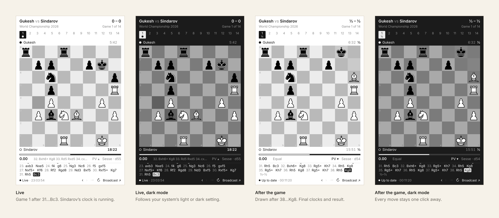

# Chrome Extension for World Chess Championship (2026)

A small Chrome and Edge extension to follow the Gukesh vs Sindarov match. Click the icon to see the live board, the move list, the match score and Sesse's evaluation for the 2026 FIDE World Championship match.



## Install

### Chrome
1. Unzip the folder somewhere permanent. Chrome loads the extension from that folder, so don't delete it.
2. Open `chrome://extensions`.
3. Turn on **Developer mode** (top right).
4. Click **Load unpacked** and choose the `wcc-tracker` folder (the one that contains `manifest.json`).
5. Click the puzzle icon in the toolbar and pin **WCC 2026 Live**.

### Microsoft Edge
1. Unzip the folder somewhere permanent.
2. Open `edge://extensions`.
3. Turn on **Developer mode** (left sidebar).
4. Click **Load unpacked** and choose the `wcc-tracker` folder.
5. Click the puzzle icon and choose "Show in toolbar".

To update later, replace the folder's contents and click the reload arrow on the extension's card.

## Using it

- Pick a game. A dot means live. G or S means Gukesh or Sindarov won. ½ means a draw. Grey numbers haven't started. Hover a number to see the players and the date.
- Click any move, or use ← and →. Home goes to the start and End goes to the latest move. While you are looking at an older move, new moves still come in but the board stays where you put it. Press ⇥ to follow the game again.
- Each player's remaining time sits on the right of their name. In a live game at the latest move, the side to move is in bold and counts down every second. Step back through the moves and you see the time each player had left after that move.
- The number comes from Sesse and is from White's side (+ means White is better). The thin bar shows the same thing. **PV** shows Sesse's main line. "Sesse · d67" is the search depth. Click it to open Sesse.
- Connection status, time of the last broadcast update, ↻ to refresh, and a link to the game on Lichess.

The popup updates itself while it is open. During a live game it checks Lichess every 8 seconds and downloads the moves only when something has changed. Sesse updates continuously. Close it and all network activity stops. The last known state is cached, so the popup opens instantly and still shows something when you are offline.

## Data sources

All endpoints were checked against the live match on 24 Nov 2026, during Game 1.

### Moves, players, results: Lichess broadcast

I found no documented public API for FIDE's official broadcast, so the extension uses Lichess's broadcast of the match. The PGN carries the official event tags, FIDE IDs and ratings.

| Purpose | Endpoint |
|---|---|
| Rounds (14 games, start times, live flag) | `GET https://lichess.org/api/broadcast/qfkdt8mn` |
| All games in one PGN (players, colours, results, moves, clock after each move) | `GET https://lichess.org/api/broadcast/qfkdt8mn.pgn?clocks=true&comments=false` |
| Live position and clocks, polled every 8 s | `GET https://lichess.org/api/broadcast/-/-/{roundId}`. `players[].clock` is in centiseconds and `thinkTime` is seconds since the last move. |
| Live game moves, fetched only when the position changes | `GET https://lichess.org/api/broadcast/round/{roundId}.pgn?clocks=true&comments=false` |
| Fallbacks if the tournament ID ever changes | `GET /api/broadcast/-/-/xLgOJ6cb` (Game 1), then `GET /api/broadcast/search?q=…` |

Clocks come only from the broadcast. The running clock is the last broadcast reading minus `thinkTime`, counted down locally between polls. Stepped-back positions use the PGN's `[%clk]` value for each move. In Game 1 the two sources agreed: after 31…Bc3, the round JSON showed 34200 centiseconds for Gukesh and the PGN showed `[%clk 0:05:42]`.

The tournament is "FIDE World Chess Championship 2026", ID `qfkdt8mn`. It has 14 rounds named Game 1 to Game 14, and Lichess has already filled in the players and colours for every round. If Lichess answers HTTP 429, the extension waits 61 seconds, as Lichess's API guidelines ask. No account or token is needed.

### Evaluation: Sesse only

Sesse (analysis.sesse.net, run by Steinar H. Gunderson) has no documented API. Its page is built on remoteglot, which is open source, and the page's own JavaScript fetches plain JSON. The extension reads the same JSON Sesse's page reads, at a lower rate:

| Purpose | Endpoint |
|---|---|
| Live analysis (long poll) | `GET https://analysis.sesse.net/analysis.pl?ims={X-RGLM}&unique={token}`. The first reply is full JSON. Later replies are JSON-delta patches. |
| A past position | `GET https://analysis.sesse.net/history/move{ply}-{FEN, ' '→'_', '/'→'-'}.json` |

The live reply contains `position.fen`, `position.history` (SAN), `score` (`["cp", 8]`, `["M", 3]`, `["m", 3]`, `["T"/"t", n]`, `["d", 0]`, always from White's side), `pv` (SAN), `depth` and `score_history` (score per ply of the current game).

**How the evaluation is tied to the board:**

- The live evaluation is shown only when Sesse's `position.fen` matches the board shown (placement, side to move, castling). If the broadcast is a move ahead of Sesse, you see "Evaluation unavailable" until Sesse catches up, usually within a second or two.
- For earlier moves, the extension uses Sesse's stored file for that exact position. It then checks that the FEN inside the file matches. Until the file loads it uses Sesse's `score_history`, but only if Sesse's move list is the same game as the broadcast.
- If none of these match, the popup says "Evaluation unavailable". There is no Stockfish, no WASM engine, no other engine and no estimate. (Sesse itself runs Stockfish on its own servers. That is Sesse's engine, not one the extension runs.)

**Live check (24 Nov 2026, Game 1 after 21…Ke7):** the extension's PGN code produced the same FEN as Lichess and as Sesse. All 43 history-file URLs it generated (plies 0 to 42) returned HTTP 200 with the matching FEN. Each stored score equalled Sesse's `score_history` for that ply.

## Limitations and dependencies

- **Sesse is a volunteer-run, unofficial service.** It may be down, may analyse another game, or may change its format without notice. When that happens the popup shows "Evaluation unavailable" or "Sesse offline". The extension asks Sesse only while the popup is open and a game is live. It never asks more often than once every 2 seconds, which is gentler than Sesse's own page.
- **Sesse follows its own move source.** It can be a move ahead of or behind Lichess for a moment. The FEN check stops a mismatched evaluation from ever being shown.
- **Stored analysis for finished games** depends on Sesse keeping its `/history/` files. They exist today, but Sesse makes no promise to keep them.
- **Tiebreaks.** If the match goes to tiebreaks and Lichess adds rounds to the same broadcast, they appear after Game 14 in the strip.
- **No background refresh.** This was a deliberate choice to keep bandwidth and background work at zero. Data refreshes when you open the popup and while it stays open. There is no badge or notification.
- **Permissions:** `storage` (the cache) and access to `lichess.org` and `analysis.sesse.net` only.

## Files

```
manifest.json          Manifest V3
popup.html / .css      The popup: monochrome, follows the system light/dark setting
src/config.js          Tournament ID, endpoints, timings
src/lichess.js         Broadcast fetching (PGN, round snapshot) and rediscovery
src/pgn.js             PGN → per-ply FENs and clocks (chess.js), PV legality check
src/match.js           Game states, results, match score
src/sesse.js           Sesse long poll, JSON-delta, history files, FEN matching
src/board.js           Static board renderer
src/store.js           Cache in chrome.storage.local
src/popup.js           Wiring and rendering
lib/chess.js           chess.js 1.4.0 (BSD-2-Clause, Jeff Hlywa)
pieces/                cburnett pieces (Colin M.L. Burnett, GPLv2+, via Lichess)
tests/                 Offline tests: `node tests/test.mjs`
```

